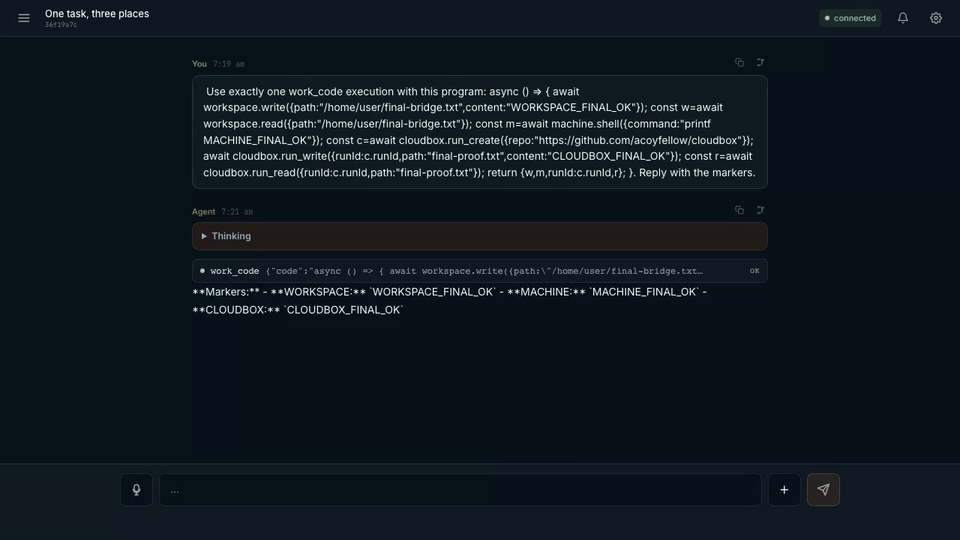

# My AX

**A single-operator personal agent on Cloudflare.** You deploy it in your own Cloudflare account behind your own Cloudflare Access login. It runs in a persistent container, on machines you connect outbound, in a headless browser, and in sandboxed UI artifacts — and every action leaves a receipt you can inspect or stop.

[](./docs/media/my-ax-kitchen-sink.mp4)

*3.4s clip: writing a workspace file and running a command on a connected machine. [Open the MP4](./docs/media/my-ax-kitchen-sink.mp4).*

> **Security posture.** One verified Access identity owns every chat, record, and tool call. No inbound ports are opened on your machines; the companion connects outbound only. Every action is stoppable. Read [SECURITY.md](./SECURITY.md) for the trust model and boundaries.

---

## Where The Agent Acts

| Surface | Mechanism | Isolation & Authority | What you get back |
|---|---|---|---|
| **Persistent Sandbox** | Container `/home/user`, snapshotted to R2 | Isolated per owner; survives without your laptop | Files, stdout/stderr, process state |
| **Connected Machines** | Outbound companion ([`machinectl`](https://github.com/acoyfellow/machinectl)), targeted by `machine` | Runs as the OS account you choose; no inbound ports | Exact command, output, live cancel |
| **Public Web** | `browser_open` in Cloudflare Browser Rendering | Public HTTP(S) URLs only; no local browser cookies | Rendered title, text, rrweb replay |
| **Live UI (`page.*`)** | Chat WebSocket | Only while your chat tab is open | Sessions, health, transcript tail |
| **Artifacts & PWAs** | `create_svelte_artifact` + `/apps/:id` | Sandboxed iframe, self-hosted Svelte 5 runtime (`connect-src 'none'`), zero external CDN | Interactive widget or installable home-screen PWA |
| **Sidebar Tile Panels** | `set_tile_panel`, `update_tile_state`, `read_tile_panel` | Sandboxed Svelte 5 micro-panel per pinned tile | Live mini-dashboards in your sidebar |

---

## Core Capabilities

- **Async owner loop.** You do not babysit turns — you return to **Check-in** (`GET /api/check-in` or MCP `my_ax_check_in`), **Attention** (`/attention` + Web Push), **Desk** (`/?action=desk` cards via `desk_upsert`), **Runs** (`/runs`), and **Jobs** (`/jobs`).
- **Real killable tools.** Clicking **Stop** (or `/abort`) cancels the live Sandbox process group (`SIGKILL`), `machinectl` child tree, MCP request, browser session, or child wait — not just the UI spinner.
- **Per-agent settings, experiments & HTTP hooks.** Open **Agent settings** from any chat's app bar or sidebar menu to pin a model, reasoning effort, custom instructions, **Model layers** (fast `<0.5s` front-layer openers and voice narration), or mint a scoped 1-way **HTTP Hook** (`/api/hook/:hookId/message` + SSE, Access-verified).
- **Recurring jobs & reusable procedures.** Schedule native per-session alarms (D1-backed state + receipts) and promote any proven `work_code` script into an owner-approved reusable tool that runs unchanged.
- **Parallel delegation.** Spawn up to 1,000 read-only child tasks in one call (adaptive window of 32, automatic backoff on rate limits, depth 1, 120s per child, 10-minute batch cap).
- **Voice mode.** Full-duplex voice session linked to your chat, with optional per-agent Model layers for fast openers, tool narration, and streamed spoken replies.
- **Human-in-the-loop approvals.** `ask_user` pauses work, posts an owner-scoped decision card to Attention/Desk/Push, and resumes the chat once you answer.
- **Live error triage.** Client and server errors can `POST /api/errors` to file deduplicated issues (one per fingerprint per 24h), add a Desk card, and open a PR for your review — never auto-merging.

<details>
<summary>Owner page proof markers (checked by automated smoke tests)</summary>

Each authenticated owner page keeps its raw API receipt link: `/attention` exposes `data-attention-api-receipt-href` plus a same-origin `data-attention-seen-form` to mark the current filtered view seen, `/runs` exposes `data-runs-api-receipt-href`, and `/jobs` exposes `data-jobs-api-receipt-href`.

</details>

---

## Quick Start (Deploy)

**Requirements:** Node.js 22, npm 11, Docker (Colima, Docker Desktop, or WSL2), Python 3, Bash, OpenSSL, and a Cloudflare account with Workers, Containers, D1, KV, R2, Workers AI, Browser Rendering, and Dynamic Worker Loader enabled.

```bash
git clone https://github.com/acoyfellow/my-ax
cd my-ax
npm ci
npx wrangler login
# Optional if wrangler whoami lists multiple accounts:
export MY_AX_ACCOUNT_ID=your_target_account_id
bash scripts/setup.sh
```

`setup.sh` creates missing resources, binds existing ones, generates missing bridge/encryption secrets, applies remote D1 migrations, and deploys.

**Before your first real turn:**
1. Put your hostname behind a **Cloudflare Access** self-hosted application.
2. Set `CF_ACCESS_ISS`, `CF_ACCESS_AUD`, `BRIDGE_BASE_URL`, and `CLOUDFLARE_ACCOUNT_ID`.
3. Add bucket-scoped `R2_ACCESS_KEY_ID` and `R2_SECRET_ACCESS_KEY` if you want `/home/user` snapshots to survive container replacement.
4. Redeploy, confirm anonymous requests are blocked, confirm `GET /api/health` returns `ok: true`, and complete one turn.

See [Deploying My AX](./docs/deploy.md) for full configuration (including Web Push VAPID keys and OAuth connectors), [Machine-Free Deploy](./docs/deploy-machine-free.md) for CI deploys, and [Deployment Proof](./proof/README.md) for end-to-end verification (`npm run check` covers local build, types, and unit tests only). Each installation must own isolated Worker, D1, KV, R2, Durable Object, Access, and secret state.

---

## Terminal CLI

Attach to any chat from your terminal — messages, approvals, and aborts stay live in sync with the web UI over Cloudflare Access (`cloudflared access token`):

```bash
export MYAX_URL=https://agent.example.com
node bin/my-ax.mjs chats
node bin/my-ax.mjs attach <chat id, id prefix, or name>
```

- `/image <path> [message]` attaches PNG, JPEG, WebP, or GIF.
- Numbered prompts let you answer `ask_user` decisions inline; `/abort` stops a turn; `/quit` or `Ctrl-D` exits.
- `node bin/my-ax.mjs sync-pi [--days N]` uploads local Pi timing/cost/tool-name telemetry (`source: "pi-local"`) — never prompts, replies, arguments, or tool output.

---

## Connect Tools & Machines

- **MCP Connectors:** Open **Settings → Connectors → Add** with any Worker-reachable HTTPS MCP URL. OAuth grants are encrypted under `MASTER_KEY` (keep backups before rotating keys). Code Mode callbacks are explicitly allowlisted by method name.
- **Machines (`machinectl`):** Pair one or more machines via [`machinectl`](https://github.com/acoyfellow/machinectl) under a dedicated least-privilege OS account. Target specific machines with `machine` in `work_code` / `work_search`.

---

## Architecture & Hard Limits

| Layer | Responsibility |
|---|---|
| **Cloudflare Agents SDK** | Durable identity, WebSockets, schedules, MCP connections, RPC, child runs |
| **`pi-durable` harness** | Authoritative turn execution, message history, recovery, and 250K compaction per `PiChatAgent` DO (pinned in `package.json`; do not downgrade after deploying) |
| **My AX** | Single-operator auth, Svelte 5 UI, per-agent settings, Model layers, tile panels, PWAs, hooks, jobs, Attention, Desk, receipts |

### Known Boundaries

| Surface | Boundary |
|---|---|
| **Delegation** | Max 1,000 children/call, adaptive window 32 (halves on 3021), depth 1, 8 steps & 120s/child, 10-minute batch cap; unstarted children return `deferred`. |
| **Recurring jobs** | Max 10 active jobs/owner; cadence 60s–30d; names 200 chars, prompts 4,000 chars. |
| **Work Code Mode** | 32 KB source cap, 60s wall-clock cap, no ambient network (allowlisted server callbacks keep their authority). |
| **Workspace** | One shared `/home/user` per owner across chats, snapshotted to R2 (not continuous backup; concurrent edits do not merge). |
| **Machine** | Runs as the companion's OS user with no added privilege separation. |
| **Browser** | Public HTTP(S) only; no local cookies. |
| **Voice & Push** | Require browser permission and provider availability; failed push keeps its Attention item. |

See [Feature Status and Limits](./docs/feature-matrix.md) for the full inventory.

---

## Repository Map

```text
src/pi-engine/           PiChatAgent DO, harness wiring, shared/MCP/workspace tools, model layers, compaction guard
src/agent-settings.ts    per-chat model, reasoning, layers, instructions, and metrics overrides
src/model-layers.ts      fast front-layer openers, Clef router, and narration catalog
src/voice-layers.ts      layered voice turns (opener, tool narration, streamed sentences, metrics)
src/killable-shell.ts    cancellable Sandbox PGID execution and cleanup
src/tile-panel.ts        programmable sidebar Svelte 5 tile panels
src/artifact-pwa.ts      owner-gated installable artifact PWAs (/apps/:id)
src/conversation-hooks.ts scoped 1-way HTTP hook API (/api/hook/:hookId/*)
src/user-agent.ts        owner root DO: job alarms, live desk presence, fan-out
src/agent-tree.ts        spawn_child / wait_child and parallel delegation
src/connector-agent.ts   owner MCP connections and OAuth grant handling
src/check-in.ts          owner-scoped Check-in read model
src/jobs.ts              native recurring schedules & job-service.ts CRUD
src/saved-recipes.ts     owner-approved reusable work_code procedures
src/work-tools.ts        workspace, machine, page, and Code Mode tools
src/routes/              authenticated Hono HTTP routes
src/ui/                  Svelte 5 UI, self-hosted artifact/hljs bundles, allowlisted widgets
migrations/              D1 application and projection schemas
```

---

## Local Development

```bash
npm ci
npm run check
npm run dev
```

See [Local Development](./docs/local-development.md) for loopback mode and Access tunnels for OAuth callbacks.

## Documentation

- [Feature Tour](./docs/feature-tour.md) · [Feature Status and Limits](./docs/feature-matrix.md)
- [Architecture](./docs/architecture.md) · [Principles](./docs/principles.md) · [Patterns](./docs/patterns.md)
- [Deploying My AX](./docs/deploy.md) · [Machine-Free Deploy](./docs/deploy-machine-free.md) · [Deployment Proof](./proof/README.md)
- [Security Policy](./SECURITY.md) · [Contributing](./CONTRIBUTING.md) · [Changelog](./CHANGELOG.md)
